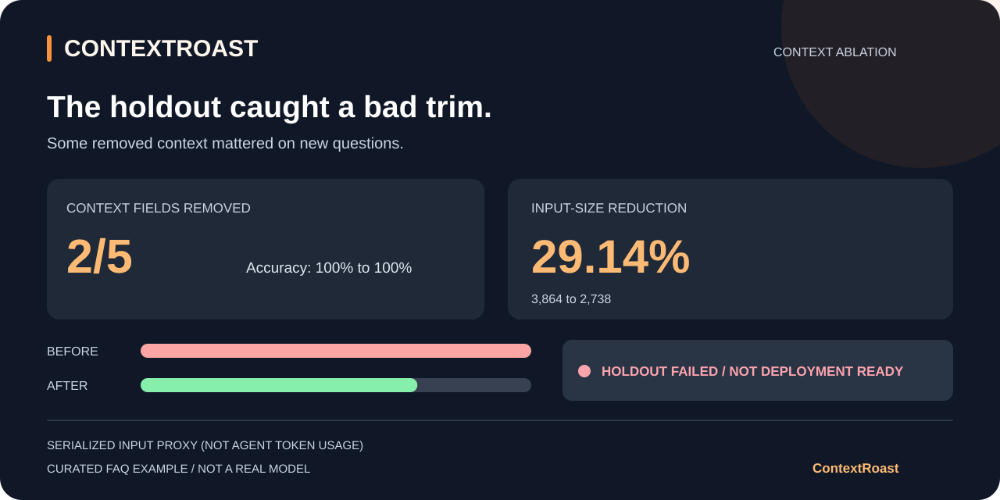

# ContextRoast

Find which context fields your LLM agent can drop without losing accuracy. ContextRoast tests removals against labelled examples, checks the result on a separate holdout, and reports the token and cost trade-offs.

Python 3.11+ · MIT · experimental alpha

## Try it

```bash
git clone https://github.com/newapple77/ContextRoast.git
cd ContextRoast
python3 -m venv .venv
source .venv/bin/activate
python -m pip install .
contextroast run examples/support.json --output-dir reports/support
contextroast roast reports/support/report.json --output reports/support/roast.svg
```

This runs an offline mock. It demonstrates the search and reporting; it does not measure savings on a real model. Open `reports/support/report.md` for the results.

## Use your own agent

Expose a synchronous function that returns a JSON-compatible prediction:

```python
# my_agent.py
def predict(case, context):
    return my_application(case.input, context)
```

```bash
contextroast run my-evals.yaml --provider python \
  --entrypoint my_agent:predict --allow-paid \
  --holdout my-holdout.yaml --export-context \
  --output-dir reports/my-run
```

Python imports and functions run without sandboxing. Use trusted code: `--allow-paid` permits execution and possible API charges; it does not cap spending. [Function contract](docs/python-agents.md) · [Dataset format](docs/datasets.md)

## Catch a bad removal

The included FAQ retriever removes two of five collections and keeps 8/8 answers correct on its optimisation set. On the separate holdout it falls from 2/2 to 1/2. ContextRoast reports the failing case, marks the exported selection as not deployment-ready, and exits 1.

```bash
contextroast run examples/retrieval.json \
  --provider python --entrypoint examples.retrieval_agent:predict \
  --allow-paid --holdout examples/retrieval-holdout.json \
  --output-dir reports/holdout
# Expected exit code: 1. Reports are still saved.
contextroast roast reports/holdout/report.json --output reports/holdout/roast.svg
```



These are curated examples. The 29.14% reduction measures serialized input size, not the agent's internal token use or API savings. Greedy removal can miss better combinations, and a small holdout cannot establish generalisation. [Example results](docs/benchmarks.md) · [Holdout checks](docs/holdout.md)

JSON and Markdown reports contain detailed results and may include sensitive data. The SVG card contains aggregate metrics only. See [security and privacy](SECURITY.md).

[CLI and accounting reference](docs/technical-reference.md) · [Contributing](CONTRIBUTING.md) · [Changelog](CHANGELOG.md) · [Releases](https://github.com/newapple77/ContextRoast/releases) · [MIT licence](LICENSE)
